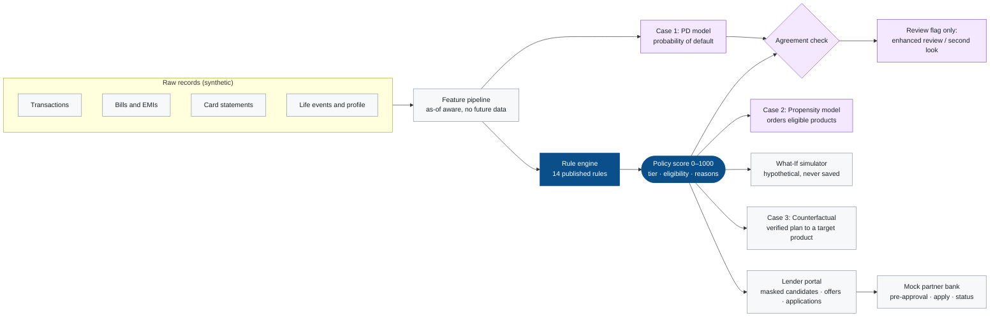

<div align="center">

# AltCredit

### A credit score you can read line by line.

**Explainable 0–1000 credit scoring for people with no credit bureau file,<br>built rule-first and checked by machine learning that is never allowed to overrule it.**


[Why AltCredit](#why-altcredit) · [How it works](#how-it-works) · [Screens](#a-look-inside) · [Results](#results) · [Quick start](#quick-start) · [Demo](#demo-script) · [Limitations](#known-limitations)


</div>

---

## Why AltCredit

Many people have never had a loan or a credit card: students, gig workers, new earners, families that pay rent and bills on time but never borrowed. A credit bureau has **no file** on them, so lenders either decline them or price them as if they were risky.

They still leave a clear financial trail: salary credits, rent and utility payments, spending patterns and savings habits. AltCredit turns that trail into a score. Three principles make that score trustworthy:

| | Principle | What it means in practice |
|---|---|---|
| **1** | **Rules decide** | Fourteen published rules produce the 0–1000 policy score, the risk tier and product eligibility. Same data in, same score out, every time. |
| **2** | **Every point is explained** | Each rule returns a reason record with the points earned, the band hit, the value measured and the exact records behind it. The dashboard, rule-influence ranking, score trace, PDF report and lender view all render from those same records, so an explanation can never disagree with the score. |
| **3** | **ML is a second opinion, never the judge** | A default-risk model and an offer-acceptance model check the rule decision and flag disagreements for human review. They **cannot** change the score, tier or eligibility, and a test enforces that. |

> The ML output is shown separately as the **ML Risk Score = 1000 × (1 − PD)** and is never called a credit score.

---

## How it works



Dark blue is the authoritative rule path; purple is the advisory ML layer. The rule engine (`backend/app/rules/engine.py`) never imports anything from the ML package.

### The 14 rules

Four components, 1,320 raw points available, clamped to a 0–1000 score. Every threshold lives in one file, [`backend/app/rules/policy.py`](backend/app/rules/policy.py), and is served read-only at `GET /api/policy`.

| Component | Rules (max points) | Max |
|---|---|---:|
| **Lifestyle** | 1.1 Employment Stability (150) · 1.2 Housing Status (80) · 1.3 Digital Footprint (70) · 1.4 Education / Skill Level (50) | 350 |
| **Spending Behaviour** | 2.1 Spend-to-Income Ratio (120) · 2.2 Expense Diversity (80) · 2.3 Cash-flow Volatility (70) · 2.4 Savings / Emergency Fund (80) | 350 |
| **Repayment Discipline** | 3.1 On-time Payment Rate (200) · 3.2 Debt-to-Income Ratio (120) · 3.3 Credit Utilization (100) · 3.4 Recent Delinquency Severity (150) | 570 |
| **Bonus / Penalty** | 4.1 Positive Financial Behaviour (+20 per habit, cap +50) · 4.2 Risk Flags (−20 per flag, floor −50) | +50 / −50 |

### Risk tiers and products

| Tier | Score | Meaning |
|---|---|---|
| T1 Very High Risk | 0–349 | below every product minimum |
| T2 High Risk | 350–549 | entry-level products only |
| T3 Moderate Risk | 550–649 | mass-market products |
| T4 Low Risk | 650–749 | standard card and lifestyle products |
| T5 Very Low Risk | 750–1000 | all products |

| Product | Lender | Minimum score |
|---|---|---:|
| Starter Credit Card | Anchorline | 350 |
| Micro-Loan Lite | Anchorline | 550 |
| Standard Credit Card | Pinewood | 650 |
| Lifestyle Rewards Card | Suryoday | 700 |
| Premium Personal Loan | Northbridge | 750 |

A product is offered only when the policy score meets its minimum. The ML models cannot change that.

### The three use cases

| Case | Question | How AltCredit answers it |
|---|---|---|
| **1 · Probability of default** | Does the ML agree with the rule decision? | L2 logistic regression on 38 raw applicant features (never the rule score or its points). Output: PD, ML Risk Score, top risk signals, and an agreement status. A rule-eligible applicant with high PD gets an **enhanced review** flag; a declined applicant with low PD gets a **second look**. |
| **2 · Offer propensity** | Which eligible product is this person most likely to accept? | Logistic regression on offer history, product terms and simulator engagement. It orders products that are **already eligible** and helps lenders target offers. It never makes anyone eligible. |
| **3 · Counterfactual** | What is the smallest realistic change that gets me to a target product? | A search over actionable levers (save more, cut discretionary spend, pay the card down, turn on autopay, smooth cash flow, start a recurring investment) and time horizons. **Every candidate plan is re-scored by the real rule engine** before it is shown. Age, city, education and past behaviour are never used as levers. |

---

## A look inside

Applicants and lenders get two deliberately different interfaces: a friendly teal app with a top menu for applicants, and a dense navy "lender console" with a sidebar for lenders.

<table>
<tr>
<td width="50%"><b>My score: every rule, ranked by influence</b><br></td>
<td width="50%"><b>What-If: a hypothetical future that never touches history</b><br></td>
</tr>
<tr>
<td><b>Goal planner: a verified plan to reach a product</b><br></td>
<td><b>Lender overview: pipeline at a glance</b><br></td>
</tr>
<tr>
<td><b>Lender candidates: masked, ranked by policy score</b><br></td>
<td><b>Candidate profile: decision drivers next to the ML check</b><br></td>
</tr>
<tr>
<td><b>Lender applications: live status from the partner bank</b><br></td>
<td><b>Portfolio analytics</b><br></td>
</tr>
</table>

### Which rules drove the decision?

Next to every rule breakdown (applicant **Home**, **My score** and **Report**, and the lender's **Decision drivers** on a candidate page) a ranking shows which rules influenced the decision most, in order:

- **Adds most** ranks rules by the points they contributed, with each rule's share of all points earned.
- **Costs most** ranks rules by points missed plus penalties, so the biggest gaps come first.
- A strip on top shows each component's share of the score (Lifestyle, Spending, Repayment, Bonus / Penalty).

It is computed in the browser from the per-rule points the API already returns, so it can never disagree with the score and nothing is re-scored. What-If and Goal planner results rank the rules that move in the same way.

### What each side can do

**Applicants**
- See their policy score, tier and eligible products on a home page with the rules shaping the score and a score-over-time chart.
- Open **My score** for all 14 rules, the influence ranking, the exact calculation, the ML check and a data-quality report.
- Run **What-If** scenarios (save more, autopay, overspend, pay late, take a loan, start a job) and see today vs "if nothing changes" vs "with this change".
- Use the **Goal planner** for a verified plan to reach a chosen product.
- Accept or decline lender offers and apply through the mock bank, then track status.
- Download a transparency report as PDF or JSON, and see income vs spending on the **Profile** page (opened from the avatar).
- New applicants sign up with just their bank statement: a PDF (text or scanned, read with OCR), a photo, or CSV/JSON. Employment and renting are inferred from the statement and the profile is scored immediately.

**Lenders**
- Start from an **Overview** with KPI tiles, a risk-tier donut, offer status and ML review flags.
- Search anonymised candidates (default policy score 650+) and filter by tier and product eligibility, with ML agreement, data quality, employment, income and city tier under **More filters**.
- Open a candidate's profile with **Decision drivers**, the full rule breakdown, the ML check and cash flow, then send single offers or bulk campaigns (only to eligible applicants) and track responses.
- See the applications submitted for their products with live bank status.
- Review **Portfolio analytics**: score distribution with the cut-off line, tiers, product reach, ML default probability and model calibration charts.
- Names and phone numbers stay masked until the applicant accepts an offer or applies for the lender's product.

**Administrators** see ingestion runs, the rule catalog, the audit log, and can ingest a single applicant.

---

## Results

All figures come from a **temporal** hold-out: models train on older records and are tested on newer ones, as they would be in production.

| Model | Test set | AUC | Other |
|---|---|---:|---|
| **Case 1 PD model** (deployed) | 1,525 applications from Mar 2025 onwards | **0.828** | Brier 0.075, expected calibration error 0.018, train AUC 0.840 |
| Rule score alone, as a default predictor | same | 0.686 | the ML adds information the rules don't capture |
| Random forest (comparison only) | same | 0.807 | beaten by the simpler, explainable model |
| Shuffled-label control | same | 0.429 | at chance level, so no leakage path |
| **Case 2 propensity model** | 3,905 offers from Dec 2025 onwards | **0.617** | modest; it is only used to order eligible products |

Other checks that pass:

- **Rule reproducibility.** The dataset's reference rule scores were reproduced for 13 of 13 rule components during the data audit, and the engine is tested against hand-computed ground truth for strong, weak and missing-data applicants.
- **Rules can't be overruled.** Every combination of tier × ML band × confidence is tested to confirm `rule_changed` is always false.
- **No future data.** Records dated after the as-of date are proven not to change any feature or score.
- **What-If never writes history.** Every simulator and counterfactual run is tested against a snapshot of the applicant's data.
- **Speed.** One rule evaluation takes about 3 ms; a full profile with ML about 11 ms.

---

## Built with

| Layer | Technology |
|---|---|
| Backend API | Python 3.11+, FastAPI, Pydantic |
| Rules and features | Pure Python + NumPy, one central policy file |
| Machine learning | scikit-learn logistic regression, pandas, joblib |
| Database | MySQL 8 (PyMySQL), append-only score history and audit log |
| Frontend | React 19, TypeScript 5.8, Vite 6, React Router, Recharts 3 (charts) |
| Reports | ReportLab (PDF) and JSON export |
| Statement reading | PyMuPDF (PDF text) and RapidOCR (ONNX OCR for scans and photos, pip-only) |
| Mock partner bank | Separate FastAPI service with API-key auth |
| Security | PBKDF2 password hashes, HMAC-signed bearer tokens, role-based access (applicant / lender / admin), PII masking, pseudonymous bank references |
| Testing | pytest (143 tests), Playwright (end-to-end browser flows) |

---

## Quick start

**You need:** Python 3.11+, Node 20+, and a MySQL 8 server (MySQL Community Server or the one bundled with MySQL Workbench). The datasets `Datasets_AltCredit_v2` and `Datasets_AltCredit` should sit next to this folder.

**1. Create the database (once)**, in a MySQL shell or Workbench:

```sql
CREATE DATABASE altcredit;
CREATE USER 'altcredit'@'localhost' IDENTIFIED BY 'devpass';
GRANT ALL PRIVILEGES ON altcredit.* TO 'altcredit'@'localhost';
```

**2. Configure.** Copy `.env.example` to `.env`. The defaults already match the database above. Change `ALTCREDIT_MYSQL_*` if yours differ.

**3. Install, seed and run:**

```bash
# Python environment
python3 -m venv .venv
.venv/bin/pip install -r backend/requirements.txt      # Windows: .venv\Scripts\pip

# Load and validate the datasets, train both models, score all 6,000 applicants,
# and create the demo logins (about 6 minutes; drops and rebuilds every AltCredit table)
.venv/bin/python backend/scripts/seed.py

# Build the frontend
(cd frontend && npm install && npm run build)

# Start the mock bank (:8001) and the API + UI (:8000)
bash scripts/run.sh
```

Open **http://127.0.0.1:8000**. The interactive API docs are at `/docs`, and the mock bank's are at `http://127.0.0.1:8001/docs`. Use `bash scripts/run.sh --dev` for hot reload on `:5173`.

`run.sh` generates the bank API key and the token-signing key on each run unless you set them in `.env`. Without a fixed `ALTCREDIT_SECRET_KEY`, everyone is signed out when the server restarts.

---

## Demo accounts

The first page is a clean sign-in page. Click **Demo accounts** under the form for one-click logins. Every seeded account uses the password in `ALTCREDIT_DEMO_PASSWORD`, or `AltCredit#2026` if that was unset when you seeded. That default is for the synthetic demo only.

| Login | Story | Seeded result |
|---|---|---|
| `demo.strong` | strong, stable applicant | 970 · T5 |
| `demo.moderate` | average profile | 575 · T3 |
| `demo.borderline` | just under the 750 premium line | 745 · T4 |
| `demo.highrisk` | high risk; rules and ML agree | 330 · T1 |
| `demo.nocredithistory` | never borrowed, scored fairly anyway | 1000 · T5 |
| `demo.missingdata` | gaps in the data, LIMITED quality | 890 |
| `demo.disagreement` | rule-eligible, but ML PD 80.8% triggers enhanced review | 660 · T4 |
| `demo.officialsample` | an applicant from the official sample file | 740 |
| `anchorline` · `northbridge` · `pinewood` · `suryoday` · `kestrel` · `vantage` | lenders | |
| `admin` | platform administrator | |

Scores are computed live by the engine from raw data; the table shows what the seed produced. Nothing on screen is hard-coded.

**Which lender receives an application?** The one that owns the product. Anchorline owns Starter Credit Card and Micro-Loan Lite, Pinewood owns Standard Credit Card, Northbridge owns Premium Personal Loan and Suryoday owns Lifestyle Rewards Card. Kestrel and Vantage have no products, so they can browse candidates but not send offers.

Lenders cannot sign up in the app; the six lender accounts are created by the seed script. Self sign-up is for applicants.

---

## Demo script

About ten minutes, and it works best with **two browser tabs** side by side. Each tab keeps its own login, so one can be the applicant and the other the lender. Open the second tab with a new blank tab rather than "Duplicate tab", which copies the login.

1. **The disagreement.** Sign in as `demo.disagreement`. The rules say 660, Low Risk, three products. The ML card, separately, says ML Risk Score 192 and recommends enhanced review. The score does not move.
2. **Why 660?** Open **My score**. The ranking on the right shows which rules drove the decision (switch to **Costs most** for the gaps); the left walks all 14 rules. Open **Show the exact calculation** and the **ML check** tab.
3. **What if?** Sign in as `demo.borderline` (745) and run the **Utility and Rent Delinquency** scenario. If nothing changes they reach 795 and Very Low Risk; with the late bills they drop to 615, fall to Moderate Risk and lose the Standard Credit Card and Lifestyle Rewards Card. The rules that moved are ranked by impact. History is untouched.
4. **How do I get there?** Back as `demo.disagreement`, open **Goal planner** and pick Lifestyle Rewards Card. The app finds a two-step plan to 725 in two months and shows each rule that moves.
5. **The lender view.** In the second tab, sign in as `pinewood`. The console looks different on purpose. Start on **Overview**, then open **Candidates**: masked and ranked by policy score. Open one to see **Decision drivers** beside the ML check, and send an offer.
6. **Accept and apply.** In the applicant tab (`demo.borderline`), open **Offers**, accept, then **Apply with the bank**. The score is re-checked, the contact is revealed to Pinewood, and the mock bank pre-approves.
7. **The application lands.** In the lender tab, open **Applications**. The application is there with its live bank status, and **Sent offers** now shows the contact.
8. **The portfolio.** Finish on **Portfolio analytics**: score distribution with the cut-off line, tier donut, PD distribution, rule-vs-ML agreement, observed default rate by tier and model calibration charts.

Also worth showing: the **Report** page (PDF and JSON transparency report) and **Create a profile**, which reads an uploaded bank statement (try the scanned sample PDF linked on that page, read with OCR) and scores it on the spot.

---

## Tests

```bash
# Backend: rule bands, tier edges, ground truth, What-If direction, leakage guards, API flow
# (the API tests use a separate MySQL database, default altcredit_test; create it once like step 1)
cd backend && ../.venv/bin/python -m pytest -q

# Frontend: typecheck and production build
cd frontend && npx tsc --noEmit -p . && npm run build

# End-to-end browser flow against the running app
bash scripts/run.sh &
cd frontend && npx playwright test          # PW_CHROMIUM=/path/to/chromium to use a local Chromium
```

---

## Project layout

```
backend/
  app/rules/policy.py        every threshold, band, tier and ML band, in one place
  app/rules/engine.py        factor values -> points, reason records, score, tier, data quality
  app/features/              raw records -> the 14 factor values (as-of aware)
  app/ml/                    PD and propensity models, agreement check, temporal training
  app/simulator/             What-If projection (status quo + hypothetical overlay)
  app/counterfactual/        target-product plan search, verified by re-scoring
  app/api/                   FastAPI routers (also serves the built UI)
  app/database/schema.sql    MySQL schema
  scripts/seed.py            ingest -> validate -> train -> score -> demo accounts
  tests/                     pytest suite
mockbank/app.py              mock partner bank (separate process, API key)
frontend/src/                React + TypeScript app (applicant, lender and admin)
  components/FactorInfluence.tsx   rule influence ranking (from existing per-rule points)
  components/Charts.tsx            Recharts charts (cash flow, score trend, donuts, distribution, calibration)
  styles.css                       .theme-user (applicant) and .theme-lender (lender console)
docs/                        architecture, rule engine, ML validation, API, data model, testing, assumptions
scripts/run.sh               starts the bank and the API + UI
```

Deeper reading: [rule engine](docs/rule-engine.md) · [ML validation](docs/ml-validation.md) · [API](docs/api.md) · [data model](docs/data-model.md) · [testing](docs/testing.md) · [assumptions and judgement calls](docs/assumptions.md).

---

## Known limitations

We would rather you hear these from us.

- **Scores are top-heavy.** The live median is 950 and 39% of live applicants hit the 1000 cap. This follows from the official rule weights and the synthetic data (70% of applicants have no credit line and get a neutral score on utilization). We did not retune the weights to hide it. As a result, the default lender filter (650+) returns most of the pool, and What-If gains for top applicants are hidden by the cap.
- **What-If changes are banded.** A change only moves the score when it crosses a band edge, so the use case's illustrative +35 / +60 examples rarely reproduce exactly. The What-If page notes this under its results.
- **The PD model leans on autopay.** `autopay_share` dominates it, and some correlated late-payment signals get counter-intuitive signs. It validates; it does not decide. Details are in [docs/ml-validation.md](docs/ml-validation.md).
- **Propensity is modest** (AUC 0.62), which is why it only orders products that are already eligible.
- **Everything is synthetic.** All people, lenders and bank responses are generated. No real credit bureau or banking API is called, and the mock bank is a stand-in for a real partner integration.
- **Some design choices are defaults.** Where the rulebook was silent (grace days, renters, multiple late bills in one month and others), documented defaults D1–D7 are applied; see [docs/assumptions.md](docs/assumptions.md).
- **Lenders are fixed demo accounts.** There is no lender onboarding flow........

---

<div align="center">

Built for the **AltCredit 2026** use case. All data is synthetic; no real personal data is used.

</div>
